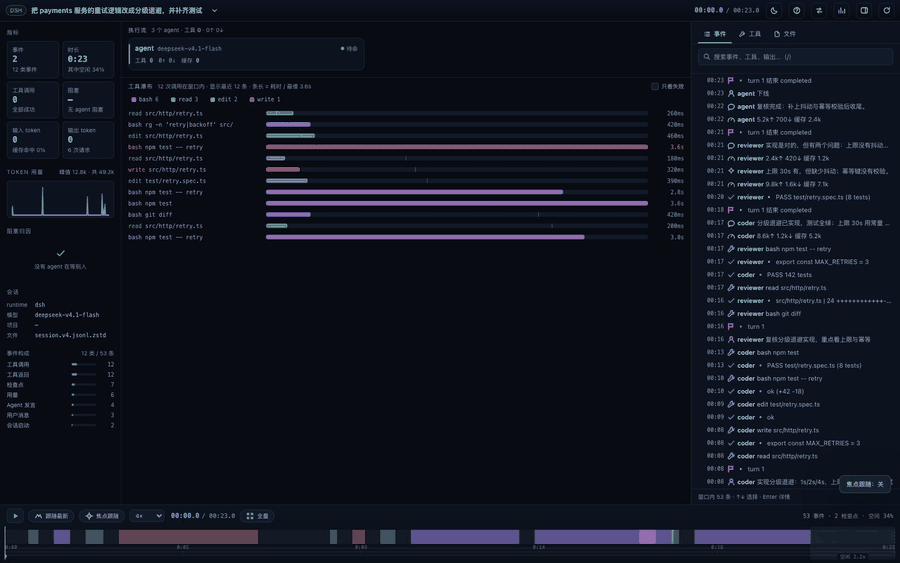
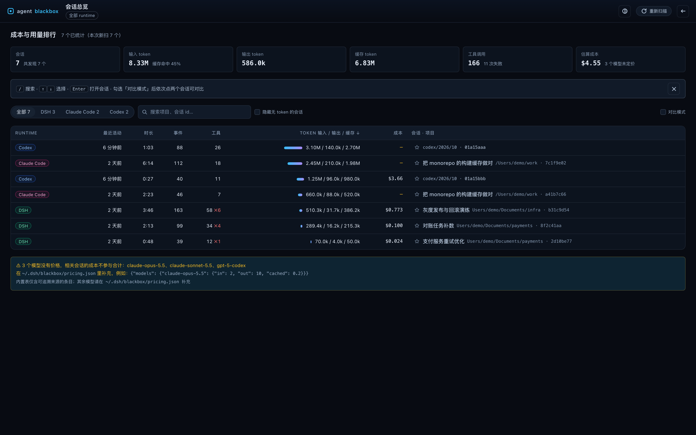
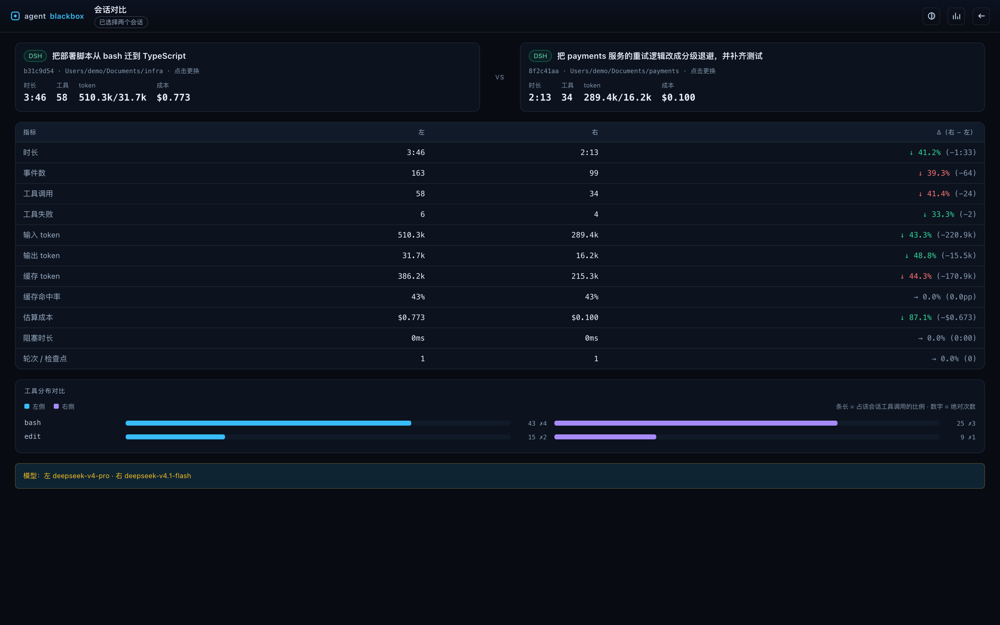

# agent-blackbox

[English](README.en.md) · 中文

AI 编程 agent 的飞行记录仪：读取各 runtime 已经写在本地的会话日志，重建为可回放、
可检查、可对比的事件时间线。所有处理都在本机完成，无网络请求、无遥测。

[](https://github.com/JasperPengC/agent-blackbox/actions/workflows/ci.yml)




<sub>暗色主题 · 4× 回放 · 合成会话 · [亮色录屏](docs/playback-light.gif) · 网速慢可以看[静态截图](docs/light.png)</sub>

## 功能

**回放**
- 时间轴缩放、框选、0.25×–8× 播放；焦点跟随自动跳过空闲并追踪当前工具 / 事件 / agent
- 工具瀑布（按耗时着色）与事件检查器（搜索、类型筛选、完整 payload）
- 回放时事件与工具随播放头逐步揭示，不会一次性铺满整窗

**分析**
- 会话总览：事件、时长、工具成功率、token、成本排行
- 双会话对比：指标差值、工具构成、最慢调用
- 多 agent：DSH 子 agent 会话合并进父时间线，独立 lane 与 token 归因

**其他**
- 多 runtime、深色 / 浅色主题、键盘优先、WCAG 2.1 AA 对比度审计
- 零运行时依赖（只用 Node 内置模块）




## 支持的 runtime

| Runtime | 数据来源 | 状态 |
| --- | --- | --- |
| DeepSeek Harness (DSH) | `~/.dsh/sessions/`（`.zstd`） | 稳定 |
| Claude Code | `~/.claude/projects/`（`.jsonl`） | 稳定 |
| Codex | `~/.codex/sessions/`（`.jsonl`） | 稳定 |
| ACP | agent-client-protocol 日志 | 实验性 |
| 录制 NDJSON | `blackbox record` 输出 | 稳定 |

## 快速开始

需要 Node.js ≥ 22.19，源码由 Node 类型擦除直接执行，无需构建。

```bash
git clone https://github.com/JasperPengC/agent-blackbox.git
cd agent-blackbox
npm install

npm run demo:ui              # 合成数据，浏览器打开
npm run demo                 # 合成数据，终端回放
node src/cli.ts sessions     # 列出本机会话
node src/cli.ts ui <文件>    # 打开指定会话
node src/cli.ts live         # 实时跟随最新会话
node src/cli.ts overview     # 终端成本排行
```

## DSH 插件

[](https://www.npmjs.com/package/dsh-agent-blackbox)

```bash
dsh plugin --profile desktop add dsh-agent-blackbox
```

重启 DSH 后侧栏出现 *Blackbox*，主区可打开整屏面板；也可以在 DSH 的
「设置 → 插件市场」里搜索 `agent-blackbox` 安装（已收录：
[dsh-plugin.org](https://dsh-plugin.org/zh/plugins/jasperpengc/dsh-agent-blackbox)）。
dshmarket 目录同样有收录：
[awesome-dsh-plugin.com](https://awesome-dsh-plugin.com/p/JasperPengC/dsh-agent-blackbox/)。
插件源码与发版在 [dsh-agent-blackbox](https://github.com/JasperPengC/dsh-agent-blackbox)。

## 实现

- **事件溯源**：任意时刻状态 = 对前缀事件的 fold；检查点让 seek 与事件总数无关
- **适配器**：DSH / Claude Code / Codex / ACP / NDJSON → 统一事件模型（16 种事件）
- **索引**：解码一次、按间隔建检查点、落盘缓存；HTTP API + 原生 JS 渲染

## 性能

Intel Mac（Core i7-10700 @ 2.90 GHz，macOS 14.8.9）、Node 24.18、Chrome 155，
合成 fixture 与 47 MB 真实会话实测。Apple silicon 上预计更快。

| 指标 | 数值 |
| --- | --- |
| 首次内容绘制 | 104–108 ms |
| 首屏数据（缓存命中） | 225–315 ms |
| 首屏数据（冷启动，47 MB 会话） | 2.0–2.4 s |
| 回放帧时间 | 中位 17 ms / p95 17 ms |
| 10 万事件建索引 | 129–132 ms |
| seek（有检查点） | 中位 80 µs / p95 145 µs / 最大 323 µs |
| 无检查点 seek | 20.6–21.8 ms |

`npm run bench` 复现索引与 seek 数字；`npm run perf` 测量首屏绘制。

## 数据与隐私

- 只读本地会话文件，不修改原文件
- 无网络请求、无遥测、无账号
- 缓存与价格表位于 `~/.dsh/blackbox/`，`blackbox cache --clear` 可清理
- 成本依赖本地 `pricing.json`；未知模型不计入成本合计，并在界面标注

## 已知限制

- 暂不支持 OpenCode / Pi 会话格式
- 超过 24 MB 的会话只加载尾部 8 MB；该模式不合并文件中段的子 agent 目录
- Claude Code 的 sidechain 事件暂未聚合为独立 lane
- 插件目前针对 DSH 验证；其他编辑器可用独立服务模式

## 相关仓库

- [dsh-agent-blackbox](https://github.com/JasperPengC/dsh-agent-blackbox) — DSH 插件（npm `dsh-agent-blackbox`）

## 参与贡献

欢迎 issue 和 PR，见 [CONTRIBUTING.md](CONTRIBUTING.md)；安全问题见 [SECURITY.md](SECURITY.md)。

## 社区

本项目在 [LINUX DO](https://linux.do) 社区推广。

## 许可证

MIT，见 [LICENSE](LICENSE)。
