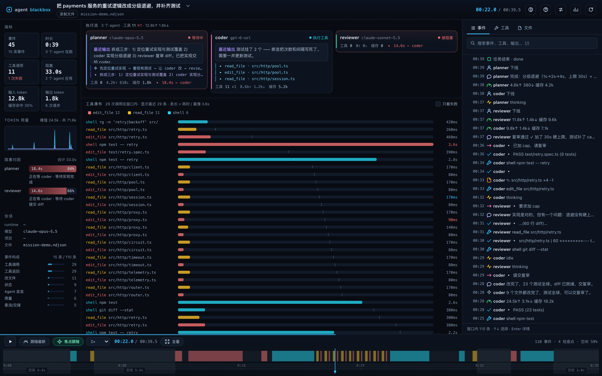
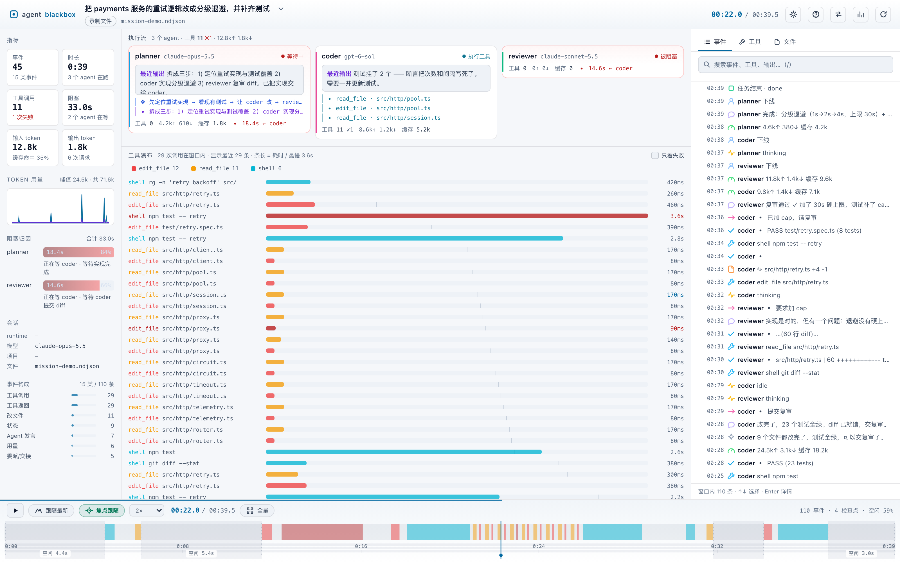

# agent-blackbox

[English](README.en.md) · 中文

AI 编程 agent 的飞行记录仪。把各 runtime 已经写在本地的会话文件，重建为一条
可回放、可检查、可对比的事件时间线。

所有处理都在本机完成：只读取本地会话文件，不上传、无遥测。

[](https://github.com/JasperPengC/agent-blackbox/actions/workflows/ci.yml)




## 解决什么问题

Agent 跑完一个会话，留下的通常只是一份扁平日志：时间花在哪、哪个工具卡住、
每个 agent 用了多少 token、两次同样的任务差在哪，都看不出来。

agent-blackbox 从事件日志重建这些信息：

- **任意时刻的状态**：`state(t) = fold(initialState, events ≤ t)`
- **时间旅行回放**：拖动时间轴、框选缩放，工具和事件随播放逐步出现
- **按 agent 记账**：工具调用、token、成本分别归属到各自 agent
- **跨会话分析**：耗时、token、失败、成本并排对比

## 功能

**回放**
- 时间轴缩放 / 框选 / 键盘拖动
- 0.25×–8× 播放；*焦点跟随*模式自动跳过空闲，并让工具瀑布、事件列表、
  agent 卡片跟随当前焦点
- 工具瀑布按开始时间排序、按耗时着色
- 事件检查器：搜索、按类型筛选、查看完整 payload
- 回放过程中事件与工具逐步揭示，而不是一次性展示整窗内容

**分析**
- 会话总览：事件数、时长、工具成功率、token、成本估算
- 全量会话成本排行，按 runtime / 项目分组
- 两个会话对比：指标差值、工具构成、最慢调用
- 多 agent：DSH 子 agent 会话会合并进父时间线，拥有独立 lane、token 与工具统计

**支持的 runtime**

| Runtime | 数据来源 | 状态 |
| --- | --- | --- |
| DeepSeek Harness (DSH) | `~/.dsh/sessions/`（`.zstd`） | 稳定 |
| Claude Code | `~/.claude/projects/`（`.jsonl`） | 稳定 |
| Codex | `~/.codex/sessions/`（`.jsonl`） | 稳定 |
| ACP | agent-client-protocol 日志 | 实验性 |
| 录制 NDJSON | `blackbox record` 输出 | 稳定 |

**其他**
- 零运行时依赖，只用 Node 内置模块
- 深色 / 浅色主题自动跟随系统或宿主应用
- 键盘优先：`/`、`⌘K`、`Space`、`F`、`↑↓`、`?`
- WCAG 2.1 AA 对比度审计已接入 CI
- 可选 DSH 插件：侧栏入口 + 主区整屏面板




## 快速开始

需要 Node.js ≥ 22.19（源码为 TypeScript，由 Node 的类型擦除直接执行）。
本地运行不需要构建。

```bash
git clone https://github.com/JasperPengC/agent-blackbox.git
cd agent-blackbox
npm install

# 合成数据演示（浏览器 / 终端二选一）
npm run demo:ui                 # 浏览器打开
npm run demo                    # 终端回放

# 打开真实会话
node src/cli.ts sessions        # 列出本机发现的会话
node src/cli.ts ui <文件>       # 浏览器打开指定会话
node src/cli.ts live            # 实时跟随最新会话（也可传会话 id）
node src/cli.ts overview        # 终端输出跨会话成本排行（--json 可选）
```

浏览器 UI 里点击顶部的「会话总览」可进入多会话成本页。

### DSH 插件

[](https://www.npmjs.com/package/dsh-agent-blackbox)

从 npm 安装（推荐）：

```bash
dsh plugin --profile desktop add dsh-agent-blackbox
```

重启 DSH 后，侧栏会出现 *Blackbox* 条目，主区可打开整屏面板。
插件复用与独立 UI 完全相同的 HTTP API 与渲染器；发布包里已内置编译后的核心，
不需要另外安装 agent-blackbox。插件源码与发版在独立仓库
[dsh-agent-blackbox](https://github.com/JasperPengC/dsh-agent-blackbox)。

也可以在 DSH 的「设置 → 插件市场」里搜索 `agent-blackbox` 一键安装
（已收录：[dsh-plugin.org](https://dsh-plugin.org/zh/plugins/jasperpengc/dsh-agent-blackbox)）。

仓库内开发时用 link 安装：

```bash
npm run plugin:install
npm run plugin:uninstall
```

## 实现

```
会话文件 ──▶ adapters ──▶ events ──▶ projector ──▶ 索引 / 检查点
                                                      │
                                          HTTP API（Node，零依赖）
                                                      │
                                          渲染层（原生 JS，canvas + DOM）
```

- **事件溯源**：会话是有序事件日志，任意时刻状态是对前缀事件的 fold；
  有检查点后 seek 与事件总数无关。
- **适配器**：每种 runtime 一个适配器，映射到统一事件模型（16 种事件：
  工具调用、消息、检查点、用量等）。
- **索引**：事件解码一次（可用 worker 线程），按固定间隔建检查点并落盘缓存，
  再次打开大会话只读缓存。
- **传输**：一个 Node HTTP 服务提供 JSON 接口，仪表盘、总览、对比页和插件共用。

## 性能

测试机为 **Intel Mac**（Core i7-10700 @ 2.90 GHz，macOS 14.8.9），Node 24.18，
Chrome 155；数据来自合成 fixture 与一个 47 MB 的真实会话。Apple silicon 上预计更快。

| 指标 | 数值 |
| --- | --- |
| 首次内容绘制 | 104–108 ms |
| 首屏数据（缓存命中） | 225–315 ms |
| 首屏数据（冷启动，47 MB 会话） | 2.0–2.4 s |
| 回放帧时间 | 中位 17 ms / p95 17 ms |
| 10 万事件建索引 | 129–132 ms |
| 10 万事件 seek（有检查点） | 中位 80 µs / p95 145 µs / 最大 323 µs |
| 无检查点 seek（从 0 折叠） | 20.6–21.8 ms |

`npm run bench` 可复现索引与 seek 数字；`npm run perf` 测量首屏绘制。

## 数据与隐私

- 以只读方式访问会话文件，不会修改原文件
- 无网络请求、无遥测、无账号
- 缓存位于 `~/.dsh/blackbox/`，可用 `blackbox cache --clear` 清理
- 成本估算依赖本地价格文件 `~/.dsh/blackbox/pricing.json`；
  没有价格的模型不计入成本合计，并在界面上标注

## 已知限制

- 暂不支持 OpenCode / Pi 会话（需要格式样本）
- 超过 24 MB 的会话只加载尾部 8 MB；该模式不会合并文件中段的子 agent 目录
- Claude Code 的 sidechain（子 agent）事件暂未聚合为独立 lane
- 成本依赖本地价格表，未知模型不显示成本
- 插件目前针对 DSH 验证；其他编辑器可使用独立服务模式

## 相关仓库

- [dsh-agent-blackbox](https://github.com/JasperPengC/dsh-agent-blackbox) — DSH 插件：
  在 DeepSeek Harness 侧栏打开本项目的仪表盘（npm 包 `dsh-agent-blackbox`）

## 参与贡献

变更记录见 [CHANGELOG.md](CHANGELOG.md)（[English](CHANGELOG.en.md)）。

欢迎提 issue 和 PR，见 [CONTRIBUTING.md](CONTRIBUTING.md)。
安全问题请参考 [SECURITY.md](SECURITY.md)。

## 许可证

MIT，见 [LICENSE](LICENSE)。
